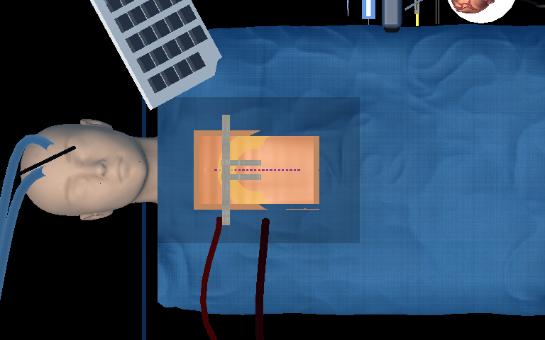
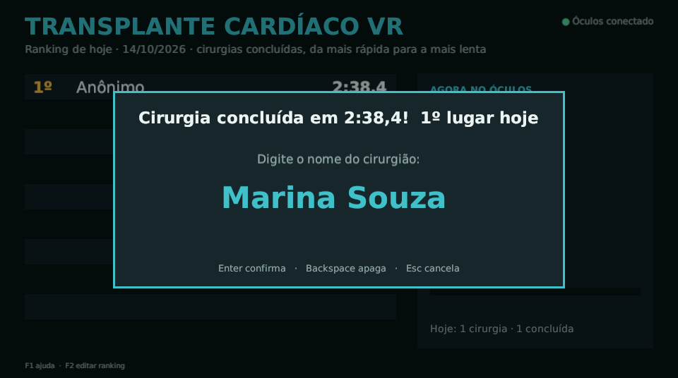
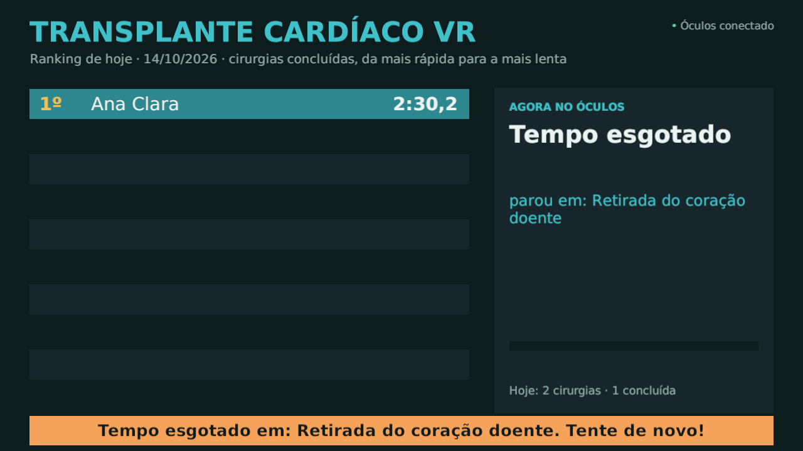

# Entrega de 14/10/2026: Simulador de Transplante Cardíaco (Meta Health)

Projeto de Iniciação Científica, FIAP. **Faltam 10 dias para o NEXT (sábado, 24/10).**

## Arquivos desta entrega

| O quê | Arquivo |
|---|---|
| Jogo para o Meta Quest (APK, 144 MB) | [MetaHealth-Quest.apk](https://github.com/Samu0990/ic-vr-game/releases/download/entrega-2026-10-14/MetaHealth-Quest.apk) |
| Documento do projeto, revisado | [PDF](Projeto_IC_Simulador_Transplante_Cardiaco_REVISADO.pdf) · [Word](Projeto_IC_Simulador_Transplante_Cardiaco_REVISADO.docx) |
| Imagens em alta resolução para a galeria | [pasta imagens](imagens/) (três em 4K) |
| Guia de montagem e operação do estande | [ESTANDE-NEXT.md](../../docs/ESTANDE-NEXT.md) |
| Este relatório em PDF | [Relatorio_2026-10-14.pdf](Relatorio_2026-10-14.pdf) |

Nesta cópia pública do documento os números de RM foram retirados. A versão com RM vai pelo sistema FIAP IC.

## O que foi feito hoje

1. **Documento do projeto revisado.** O texto que estava no sistema descrevia outro projeto
   (módulos de Ciências na Associação Passos Mágicos) e trazia resultados de uma pesquisa que não
   fizemos (32 alunos, SUS 82,4). Reescrevi descrevendo o simulador de transplante como ele é, sem
   resultado inventado. A avaliação com o público fica como planejada para o NEXT. Também consertei
   o sumário e o título que aparecia nas propriedades do arquivo.
2. **Imagens em alta.** Quatro imagens prontas para a galeria, três em 4K.
3. **Bugs e melhorias.** Levantei 12 itens. Dos 5 que travavam o estande, 4 já estão corrigidos;
   o quinto (calibrar o projetor) depende do teste físico.
4. **Sistema do estande pronto:** projetor sobre o manequim, monitor com o ranking do dia e nome
   digitado no notebook ou no próprio óculos (detalhes abaixo).
5. **Um nível só**, com ajuda automática para quem fica para trás, no lugar de níveis de dificuldade.
6. **APK do Quest gerado**, com o nome **Meta Health**.
7. **Testes automáticos:** 289 testes, 286 passam e nenhum falha. Os outros 3 só rodam com o óculos
   conectado.

## Como o estande funciona

```
Meta Quest (jogo, sem fio) ──Wi-Fi──► Notebook (central do estande)
                                        ├─ HDMI ► Projetor: paciente visto de cima
                                        ├─ cabo ► Monitor: ranking do dia
                                        └─ teclado: nome de quem terminou
```

- **O jogo roda sozinho no Quest**, sem cabo no visitante. O notebook do estande (Linux, vídeo
  integrado) não consegue rodar o jogo pelo cabo do Quest. Por isso a proposta da manhã, de um PC com
  três saídas de vídeo, foi trocada por esta: o notebook só recebe a imagem e os resultados pela rede.
- **Projetor:** mostra só o paciente do jogo visto de cima, do peito à cabeça, e tudo em volta fica
  preto. Assim a luz cai no manequim e não acende a bancada. Mostra o que o visitante está fazendo:
  corte, tórax aberto, coração. O ajuste ao manequim é feito pelo teclado (mover, zoom, girar,
  espelhar, padrão de teste) e fica salvo.
- **Ranking:** os 10 melhores tempos do dia. Zera sozinho a cada dia e não se perde se o programa
  fechar. Quem conclui digita o nome no notebook ou no teclado do próprio óculos. O operador pode
  corrigir ou remover um nome impróprio.
- **Dados para a pesquisa:** cada dia gera uma planilha com todas as rodadas, inclusive as que não
  terminaram: tempo, pontos, etapa alcançada e nome.
- **Rede:** o Quest e o notebook precisam estar na mesma rede. Wi-Fi de evento costuma isolar os
  aparelhos, então usamos o ponto de acesso do notebook ou de um celular. A central acha o óculos
  sozinha.

**Testado até agora:** a central foi testada de ponta a ponta com um programa que imita o Quest:
conexão automática, imagem no projetor, nome digitado no notebook e no óculos, tempo esgotado e
ranking. **Falta testar com o Quest de verdade** na próxima sessão com o óculos.

| Projetor: o paciente visto de cima | Ranking: nome de quem terminou |
|---|---|
|  |  |



## Bugs e melhorias: situação

| Prioridade | Problema | Situação |
|---|---|---|
| P0 | Ajuste de altura: criança não chegava à mesa e adulto alto não alcançava o paciente | **Corrigido.** Cada visitante joga na própria altura; quem é baixo é levantado. Conferir no óculos. |
| P0 | A cirurgia automática de demonstração não reiniciava entre visitantes | **Corrigido.** |
| P0 | Órgão na mão contava como implantado ou retirado | **Corrigido**, e o teste automático que falhava ao acaso foi estabilizado. |
| P0 | A ferramenta ficava no peito do paciente depois de solta | **Corrigido:** solta em cima do corpo, volta para a bandeja. Conferir no óculos. |
| P0 | Projeção no manequim nunca calibrada | **Em andamento:** calibração pronta no notebook; falta o teste físico. |
| P1 | Bisturi atravessado na palma da mão | Pendente: decidir no óculos entre realismo e conforto. |
| P1 | Polegar a 5,6 mm do cabo do bisturi | Pendente, junto com o item acima. |
| P1 | Lugares que a ferramenta não alcança | Provavelmente resolvido com o ajuste de altura. Conferir no óculos. |
| P1 | Trabalho "mesma imagem no notebook e no Quest" fora da versão principal | Reavaliar: o estande agora usa a central do notebook. |
| P2 | Textos clínicos e modelos anatômicos sem revisão de profissional | Pendente: pedir revisão a um cirurgião cardiovascular. |
| P2 | Desempenho nunca medido no óculos | Pendente: medir na sessão com o óculos, com o projetor ligado. |
| P2 | Questionário de avaliação e termo de consentimento | Pendente. |

## O que falta até o NEXT

| Quando | O quê |
|---|---|
| qui 15/10 | Subir documento e imagens no sistema FIAP IC. Fechar quem faz o quê com o grupo. |
| sex 16/10 | Teste físico: bancada, manequim de tronco, projetor, monitor e notebook. Calibrar a projeção. |
| sessão com o óculos | Instalar o APK e testar com o Quest: desempenho, altura, alcance e ferramenta voltando à bandeja. |
| seg 19/10 | Primeiro ensaio completo, com alguém de fora jogando. Questionário e termo prontos. |
| qua 21/10 | Código congelado. Versão final e uma reserva. |
| qui 22/10 | Ensaio geral com a equipe: fila, questionário, higiene do óculos. |
| sex 23/10 | Transporte e montagem. |
| **sáb 24/10** | **NEXT** |

**Equipamento:** Meta Quest e carregador, notebook e carregador, projetor com cabo HDMI e suporte
acima do manequim, monitor com cabo (DisplayPort ou USB-C), manequim do tronco para cima, extensão
elétrica e material de higiene do óculos.

## Perguntas para o orientador

1. A bancada de 1,40 m × 60 cm: os 60 cm são a **altura** ou a **profundidade**? Muda a posição do
   projetor.
2. O questionário com o público precisa passar pelo **Comitê de Ética**?
3. Quem do grupo fica com o teste físico, o questionário, a logística e a escala de turnos?

---

Código-fonte completo neste repositório. Instalação no Quest: veja *Instalar no Quest* no
[guia do estande](../../docs/ESTANDE-NEXT.md).
